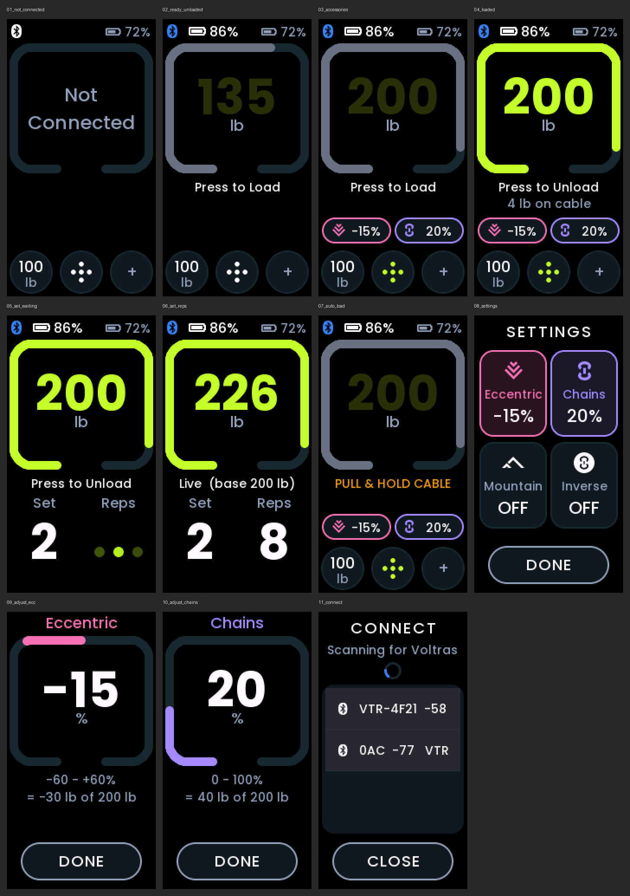
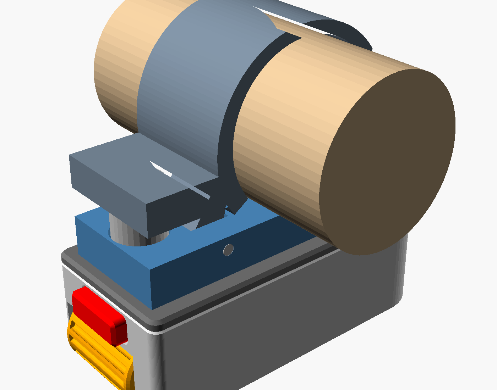
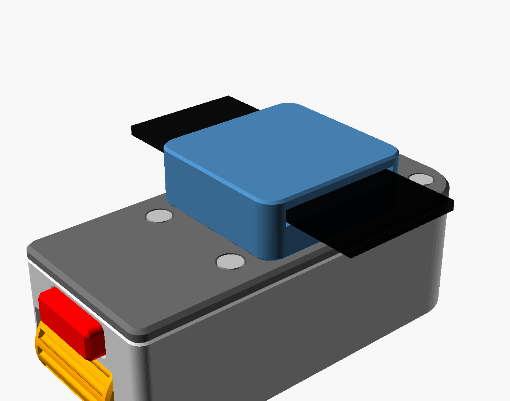

# Voltra Ring

A dedicated handheld Bluetooth remote for the **Beyond Power Voltra I**, built on the
[Waveshare ESP32-S3-Touch-LCD-1.47](https://docs.waveshare.com/ESP32-S3-Touch-LCD-1.47)
in a 3D-printed case with a scroll wheel and a load button. Set the weight, load and
unload, and control chains, inverse chains, mountain, and eccentric, without reaching for
the Voltra's screen or your phone.

It is a port of [Voltra Remote](https://github.com/kirby6365/voltra_remote) (the round
knob version) to this board: same protocol and client code, new display, touch and input
drivers, and a UI laid out for the tall 172 × 320 screen.

> **Unofficial.** This is an independent project, not affiliated with or endorsed by
> Beyond Power. It drives the Voltra through a reverse-engineered protocol, and a
> firmware update could change that protocol. Use it at your own risk, and keep clear of
> the cable when loading.



```
   ┌────────────────┐
   │ ᛒ ▮▮ 86%  ▮ 72%│  <- Voltra battery (tap: connect menu) · remote battery
   │   ╭──────╮     │
   │  │  200   │    │  <- wheel: weight
   │  │   lb   │    │
   │   ╰─    ─╯     │
   │ Press to Load  │  <- what the button will do
   │ ⩔ -15%  8 20%  │  <- active accessories (tap to adjust)
   │ (100) ⁘  ( + ) │  <- presets either side of the settings button
   └────────────────┘
        [button]        <- press: load / unload · hold: auto load
```

## Features

- **Weight on the wheel.** Roll slowly for 1 lb steps, spin for 5 lb steps that snap to
  multiples of 5. The weight stops at the Voltra's own max-weight setting (up to 250 lb),
  and follows it when you change it on the Voltra.
- **Load, unload and auto load on the button.** Press to load or unload, from any screen.
  It works with the cable already pulled out too (the Voltra's direct load): the remote
  checks where the cable is and loads either way. Hold it to start the Voltra's own auto
  load: pull the cable out and hold it, and it loads after a 3-second countdown that the
  screen shows too. Touching the screen never loads the cable.
- **Always in step with the Voltra.** The screen follows what the Voltra reports, so
  changes made on the Voltra itself show up here. The weight is a dim green while
  unloaded and bright green once loaded, and resting between sets still counts as loaded.
- **Set screen.** During a set, the controls clear away and the set and rep counts fill
  the lower half. Until the first rep, the rep count pulses like the Voltra's.
- **Live weight.** With chains, inverse chains, mountain or eccentric on, the big number
  follows the actual resistance through each rep during a set, as the Voltra's own screen
  does, with the base weight shown under it.
- **Two weight presets.** Hold a preset to store the current weight, tap it to send that
  weight. They are stored on the remote and survive a restart.
- **Accessories** with the Voltra's own icons: eccentric, chains, inverse chains and
  mountain. The last three are mutually exclusive, as on the Voltra. Amounts follow the
  Voltra's lb/% setting; the adjust screen shows the other unit too.
- **Status at a glance.** Bluetooth icon (blue when connected), the Voltra's battery, and
  the remote's own battery.

## What you need

- A Beyond Power **Voltra I**. Tested against current firmware, which allows up to 250 lb.
- A **Waveshare ESP32-S3-Touch-LCD-1.47** (with touch; ESP32-S3R8, 16 MB flash).
- The [3D-printed case](#3d-printed-case-and-mounts) and its parts: a mouse-wheel style
  rotary encoder, a 6 × 6 mm tact switch, a strip of protoboard, a 10 × 25 × 35 mm LiPo,
  M2 screws, and 6 × 3 mm magnets. Optional: the barbell clamp or band plate mounts.
- A USB-C data cable, and a computer with [PlatformIO](https://platformio.org/) (the
  VS Code extension, or the `pio` command line).
- A soldering iron, to [remove the board's power LED](#remove-the-power-led) so the
  battery lasts while powered off.

## Remove the power LED

The board's red power LED (LED2, with its 2.2 kΩ resistor R23) is wired straight across
the supply: it is lit whenever the board has power, from USB or the battery, and no
software can turn it off. On battery it draws about 1 mA, many times everything else
left on in deep sleep put together, so with it fitted a powered-off remote still drains
its battery in a few weeks.

Desolder either LED2 or R23 (either one breaks the circuit; the resistor is often the
easier part to lift). Nothing else depends on them. The other LED, the charge indicator
(LED1), only lights while charging over USB and stays.

## Wiring

All three controls switch to GND; the firmware turns on the ESP32's internal pull-ups.

| Control | Pin on the board's header |
|---|---|
| Encoder A | GPIO 9 |
| Encoder B | GPIO 11 |
| Encoder common | GND |
| Push button | GPIO 2, other leg to GND |

## 3D-printed case and mounts

Everything printable is in [`case/`](case): `esp32s3_lcd147_case.scad` is the OpenSCAD
source (every dimension a named variable near the top, the assembly steps in its header),
`case/stl/` holds the exported parts and `case/renders/` some previews.

The lid doubles as a **magnetic backplate**, and two mounts snap onto it: a spring
**barbell clamp** with TPU grip liners, and a **band plate** that takes an elastic strap
so the remote can be worn like a ring.

| Mounted on a bar | Band plate (ring) |
|---|---|
|  |  |

### Parts

| STL | Material | Print | Notes |
|---|---|---|---|
| `esp32s3_lcd147_tub.stl` | PLA / PETG | display face down | the case body |
| `esp32s3_lcd147_lid.stl` | PLA / PETG | outer face down, no supports | magnetic backplate |
| `esp32s3_lcd147_wheel.stl`, `_shaft.stl` | PLA / PETG | as exported | scroll wheel and its shaft |
| `esp32s3_lcd147_button.stl` | PLA / PETG | as exported | button bar on the end face |
| `esp32s3_lcd147_clip_a.stl` | PLA / PETG | top (magnet holes) on the bed | clamp: upper jaw |
| `esp32s3_lcd147_clip_b.stl` | PLA / PETG | side profile on the bed | clamp: lower C jaw |
| `esp32s3_lcd147_liner_a.stl`, `_liner_b.stl` | **TPU** | as exported | clamp grip liners |
| `esp32s3_lcd147_band_20.stl` | PLA / PETG | underside on the bed, magnets up | band plate for a 20 mm band |
| `esp32s3_lcd147_band_13.stl` | PLA / PETG | underside on the bed, magnets up | the same band plate for a 1/2" (13 mm) band |
| `esp32s3_lcd147_fit_test.stl`, `_fit_tips.stl` | PLA / PETG | as exported | optional test prints for the shaft's small hex fits (encoder tip and wheel bore); pick `key_print` / `drive_bore` in the SCAD for your printer before printing the shaft and wheel |

**Hardware**

- 4 × M2 × 12 socket head cap screws for the lid, into the board's brass standoffs (the
  SCAD echoes the length it needs when rendered).
- 6 mm × 3 mm round magnets: 2 in the lid, plus 2 for each mount you print.
- For the clamp: a 23/64" × 1-3/8" compression spring (about 9.1 mm OD × 34.9 mm long;
  a shorter 3/8" × 5/8" spring is too weak to hold the clamp shut), and a pivot pin: an
  M2 × 20 screw and nut, a 2 mm pin, or a length of 1.75 mm filament.
- For the band plate: a 20 mm wide elastic band, or a 1/2" (13 mm) one for the narrow
  plate, such as a 1/2" elastic hook-and-loop strap.

### Magnetic backplate

Two magnets are glued into shallow pockets on the lid's centreline and stand slightly
proud of it. Each mount has two matching stepped holes with its own magnets glued at the
bottom: the lid's magnets slide into the holes and meet the mount's magnets face to face,
which both holds the mount and locates it.

**Polarity:** glue the lid's two magnets with opposite poles facing out (one N, one S).
Then stick each loose mount magnet onto the lid magnet it will meet, mark its exposed face,
and glue it into the mount with that marked face up. Both pairs then attract, and a mount
only goes on one way round.

### Barbell clamp

A spring clip that grips a bar running across the remote. The upper jaw carries the
magnets and a saddle over the top of the bar; the lower C jaw wraps underneath and pivots
on the pin, and the spring between the two tails holds it shut. Squeeze the tails
together to open it.

- Sized for a 30 mm bar by default. Change `handle_d` in the SCAD for a different bar and
  re-export the clamp parts and liners.
- The **TPU liners** slide into dovetail grooves in each jaw from the +X side until they hit
  the stop at the other end. Their ribs are what grip the bar.

### Band plate (ring)

A low plate with the magnet holes on top and a sideways tunnel underneath for an elastic
band. Thread the band through and close it into a loop round your finger or hand, and
the remote sits on the back of it like a ring.

It comes in two widths with the same outside: `band_20` for a 20 mm band and `band_13`
for a 1/2" (13 mm) one. For another width, set `strap_w` (and `strap_t` for the tunnel
height) in the SCAD and render `part="band"`.

### Rendering parts yourself

```bash
openscad -D 'part="clip_a"' -o clip_a.stl case/esp32s3_lcd147_case.scad
```

The part names are listed at the bottom of the SCAD file: `tub`, `lid`, `wheel`, `shaft`,
`button`, `clip_a`, `clip_b`, `liner_a`, `liner_b`, `band`, `fit_test` and `fit_tips` for
printing, and `mount` / `mount_band` for assembled previews. `band` uses `strap_w`
(20 mm by default); the 13 mm plate is the same part with `-D 'strap_w=13'`.

## Installing

1. Clone this repository and open a terminal in it.
2. Connect the board over USB-C. The ESP32-S3 shows up as an Espressif USB device.
3. Build and flash:

   ```bash
   pio run -e remote -t upload
   ```

   The first build downloads the toolchain and libraries, which takes a few minutes.

**Windows:** build from PowerShell or cmd, not Git Bash/MSYS. The toolchain installer
refuses to run under MSYS and leaves the compiler missing, so the build then fails
with `'xtensa-esp32s3-elf-gcc' is not recognized`.

Each build also writes a single flashable image, `.pio/build/remote/firmware.factory.bin`,
which can be written at offset `0x0` with any ESP32 flasher, such as
[ESP Web Flasher](https://espressif.github.io/esptool-js/).

### First-time setup checks

Three things depend on your parts and how you hold the case; each is one line in
`platformio.ini`:

- **Picture upside down?** Flip `-DLCD_ROTATE_180` (set to 1 for the case as built).
  Touch follows the picture.
- **Wheel goes the wrong way?** Flip `-DKNOB_INVERT` (set to 1 for the case as built).
- **One detent moves two steps, or it takes two detents to move one?** Change
  `-DKNOB_COUNTS_PER_DETENT` (1 for the case's encoder; 2 or 4 suit other encoders).

## Using it

**First connection.** Switch the Voltra on and press the button, or tap the top-left of
the screen (or the weight box, while disconnected), to open the connect menu. Tap your Voltra
(`VTR-…`) in the list. The remote remembers it and reconnects by itself from then on. To
disconnect, open the connect menu again.

**Main screen**

| Do this | To |
|---|---|
| Roll the wheel | set the weight (slow: 1 lb, fast: 5 lb) |
| Press the button | load / unload (also with the cable already pulled out) |
| Hold the button about a second, then let go | start auto load; press again to cancel it before it loads |
| Hold the button 5 s (through the countdown) | power off; let go during the countdown to cancel |
| Tap a preset | send its weight |
| Touch and hold a preset | store the current weight in it |
| Tap an accessory chip | adjust that accessory |
| Tap the five-dot button | open the accessory settings |

**Accessory settings.** Four tiles: Eccentric, Chains, Mountain and Inverse. Tap one and
roll the wheel to set its amount, then tap Done. Dialling an amount into Chains, Mountain
or Inverse switches the Voltra to that style and turns the other two off. The five-dot
button turns green while any accessory is on. The button still loads and unloads from
these screens, and brings you back to the weight.

**Power.** Holding the button for 5 seconds powers the remote off: it disconnects from
the Voltra, the screen goes dark once you let go, and the ESP32 drops into deep sleep with
only the button able to wake it. To power on, hold the button for about 3 seconds; a
shorter press goes straight back to sleep without lighting the screen. The remote then
reconnects to your Voltra by itself. The board's reset button and plugging in USB do not
wake it (reset restarts it normally). Flashing needs it awake: power it on first, or hold
BOOT while pressing reset.

A few things stay powered because the board wires them straight to its supply: the
regulator itself, the screen and touch chips (both in their sleep modes), and the
battery-sense resistor divider, which draws about 14 µA on its own. That should add up to tens
of µA, but only once the [power LED is removed](#remove-the-power-led); left in, the LED
alone draws about 1 mA. For a true zero, put a switch in the battery lead.

## Troubleshooting

- **The Voltra doesn't appear in the connect menu.** Make sure it is switched on, and
  close the Beyond+ app on your phone if it is connected: the Voltra may not advertise
  while another app holds the connection.
- **The wheel does nothing.** Check the encoder's common pin goes to GND and A / B to
  GPIO 9 / 11. See [first-time setup checks](#first-time-setup-checks) for direction and
  step size.
- **Something on the screen disagrees with the Voltra.** The remote re-reads the Voltra
  every few seconds; if it stays wrong, open an issue with what you did on each device.

## Development

| Path | What |
|---|---|
| `src/voltra/voltra_protocol.*` | Frame builder/parser, CRCs, parameter registry. No Arduino dependencies, so it is unit-tested on the host. |
| `src/voltra/voltra_client.*` | NimBLE central: scan, connect, handshake, paced writes, load handling, device state. |
| `src/ui/ui.cpp` | LVGL 8 screens: main, set, accessory settings, adjust dial, connect menu. |
| `src/ui/knob_step.h` | Fine/coarse wheel stepping and snapping (unit-tested). |
| `src/ui/fonts/` | Generated fonts: Poppins text and numbers, and the icon font. |
| `src/hw/` | Board drivers: SPI JD9853 panel and LVGL port, AXS5106L touch, wheel (pulse counter), button, deep-sleep power off / on, battery. `haptics.*` drives an optional DRV2605 on the I²C bus and stays silent without one. |
| `include/board_pins.h` | Pin map. |
| `include/lv_conf.h` | LVGL configuration. |
| `tools/` | Font and icon generators, the diagnostic sweep generator, and the Poppins font files. |
| `test/test_protocol/` | Unity tests, mostly against frames captured from the Voltra and the official app. |
| `docs/PROTOCOL.md` | Everything known about the Voltra's BLE protocol. |
| `case/` | The case: OpenSCAD source, STLs and renders. |

**Tests.** 30 host-side tests cover the frame builder and parser against captured
frames, the wheel stepping, the load, auto-load and workout-status logic, the weight
limit, the live weight, and when the cable counts as pulled out:

```bash
pio test -e native
```

**Builds.** `remote` is the release build and prints nothing over serial. `remote_diag`
adds full logging and a register sweep for protocol work; see
[docs/PROTOCOL.md](docs/PROTOCOL.md#finding-undocumented-registers).

**Fonts and icons.** The generated files are committed; regenerate them only to change a
size or a shape. Both generators need Python with Pillow. The UI is set in Poppins:
Medium for text, Bold for numbers. The text sizes fall back to LVGL's built-in
Montserrat for the Bluetooth and battery symbols, which Poppins lacks.

```bash
# text, 14/16/18/20/22 px (16 shown)
python tools/gen_font.py --ttf tools/Poppins-Medium.ttf --size 16 --ascii \
    --fallback lv_font_montserrat_16 --name font_poppins_16 --out src/ui/fonts/font_poppins_16.c
# the weight and dial values, and the set / rep counters
python tools/gen_font.py --ttf tools/Poppins-Bold.ttf --size 56 --chars "+-0123456789" \
    --name font_poppins_bold_56 --out src/ui/fonts/font_poppins_bold_56.c
# icons: drawn from shapes, at U+E000-U+E004 (the ICON_* macros in ui.cpp)
python tools/gen_icons.py --size 26 --name font_icons_26 --out src/ui/fonts/font_icons_26.c --preview icons.png
python tools/gen_icons.py --size 18 --name font_icons_18 --out src/ui/fonts/font_icons_18.c
```

**Board pins** (ESP32-S3 side, from the Waveshare schematic):

| Function | GPIO |
|---|---|
| LCD SPI CS / SCK / MOSI / DC / RST / backlight | 21 / 38 / 39 / 45 / 40 / 46 |
| I²C SDA / SCL (AXS5106L touch `0x63`) | 42 / 41 |
| Touch RST / INT | 47 / 48 |
| Wheel encoder A / B | 9 / 11 |
| Load button | 2 |
| Battery ADC (200k/100k divider) | 12 |

## License

The firmware, documentation and 3D-printable case files are released under
[Creative Commons Attribution-NonCommercial 4.0](https://creativecommons.org/licenses/by-nc/4.0/)
(CC BY-NC 4.0; full text in [LICENSE](LICENSE)): you may share and adapt them for
non-commercial purposes, with attribution. For commercial use, ask first.

Some files keep their own licences: the JD9853 panel driver (`src/hw/lcd_jd9853_panel.*`)
is Apache License 2.0, the generated font files in `src/ui/fonts/font_poppins_*.c` embed
glyphs from Poppins and remain under the SIL Open Font License, and the board model in
`case/` is Waveshare's. The third-party components below keep their own licences too.
Earlier Voltra Remote releases published under the MIT License stay under those terms.

## Credits

The protocol work builds on community reverse-engineering by
[dylanmaniatakes/Beyond-Power-HomeAssistant](https://github.com/dylanmaniatakes/Beyond-Power-HomeAssistant),
[dylanmaniatakes/Beyond-Power-Voltra-Android](https://github.com/dylanmaniatakes/Beyond-Power-Voltra-Android)
and [jpamorgan/voltra-sdk](https://github.com/jpamorgan/voltra-sdk). The accessory and
settings icons are redrawn after the Voltra's own. The JD9853 panel driver and its init
sequence come from Waveshare's demo code for the board (after Espressif's esp_lcd
drivers, Apache License 2.0).

Third-party components:

- [LVGL](https://lvgl.io/): MIT License.
- [NimBLE-Arduino](https://github.com/h2zero/NimBLE-Arduino): Apache License 2.0.
- [Poppins](https://github.com/itfoundry/Poppins) (via Google Fonts) and LVGL's built-in
  Montserrat: SIL Open Font License 1.1 (`tools/Poppins-OFL.txt`).
- [Arduino core for ESP32](https://github.com/espressif/arduino-esp32): LGPL 2.1; ESP-IDF: Apache License 2.0.

Beyond Power and Voltra are trademarks of their respective owner, used here only to
identify the device this remote works with.
